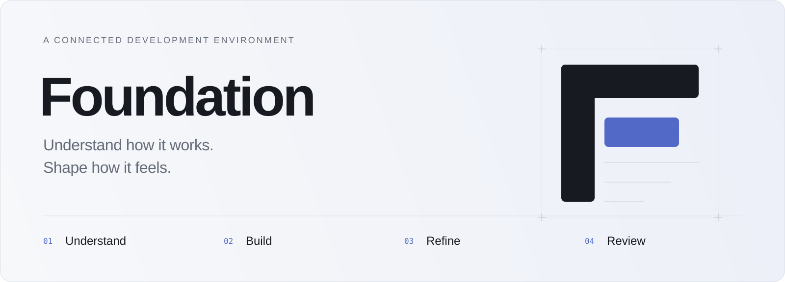

<picture>
  <source media="(prefers-color-scheme: dark)" srcset="docs/media/foundation-cover-dark.svg">
  <source media="(prefers-color-scheme: light)" srcset="docs/media/foundation-cover-light.svg">
  
</picture>

  <strong>A development environment for the whole product.</strong> 
  Code, interface design, runtime behavior, and AI — connected in one workspace.

  <a href="docs/functionality.md">Functionality</a> ·
  <a href="docs/product-checklist.md">Roadmap</a> ·
  <a href="docs/architecture.md">Architecture</a> ·
  <a href="LICENSE.txt">Source terms</a>

---

Foundation is being built for design engineers who move between implementation, interface design, and product behavior. Its purpose is to make those connections visible: from an element on screen to its source, from an interaction to an observed request, and from a proposed change to the evidence behind it.

Built on **Code OSS**, Foundation retains a professional editor, search, Git, terminals, and debugging surfaces. It adds a connected product workspace, visual refinement tools, and AI collaboration with explicit context and reviewable changes.

> **Development preview · 0.47 · macOS on Apple Silicon** 
> Source is available for inspection. There is no general-release application download yet. Implemented workflows have documented project and platform limits.

## One task. Four connected activities.

| | Activity | What you can do |
| :--- | :--- | :--- |
| **01** | **Understand** | Follow a feature into its components, functions, styles, consumers, and observed behavior. |
| **02** | **Build** | Write in the native editor, work with AI in context, and prepare coordinated source changes. |
| **03** | **Refine** | Inspect the interface, experiment with design tokens, and compare states and alternatives. |
| **04** | **Review** | Examine source diffs alongside checks, requests, and visual evidence before applying a change. |

Your feature, source selection, and supporting evidence stay connected as you move between activities.

## Follow the product into the code

Start with a Save button in an instrumented React/Vite app. Select it to find its mapped source and measured properties. Observe its interaction and inspect the captured request timeline. Prepare an AI request with chosen context, review the proposed scope, and compare the resulting states before accepting the source change.

Each connection carries its limits. Source relationships, observed requests, AI interpretations, and unknown behavior are labeled separately. Compilation, interaction, and visual assessment remain independent outcomes.

[Explore connected inspection →](docs/connected-web-runtime.md)

## AI you can work with

The Assistant lives in an **expandable, resizable panel on the far right**. Ask, Plan, Build, and Review have distinct workflows, with durable conversations and interactive artifacts.

- **Choose the context.** Select saved source, the task brief, and supported runtime evidence before sharing.
- **Shape the work.** Edit plans, stop and revise requests, refine staged changes, and compare alternatives.
- **Review the change.** Inspect native diffs, run supported checks, and accept changes explicitly. Revision guards and Undo protect unrelated work.
- **Stay in the editor.** Selected-range edits, current-file suggestions, and nearby-edit review keep assistance close to the code.

Provider adapters support OpenAI, Anthropic, and compatible endpoints. Live paid-provider acceptance remains open. Core editing works without an AI connection.

[AI workflows](docs/ai-workflows.md) · [Inline editing](docs/inline-selection-editing.md) · [Change groups](docs/isolated-change-groups.md)

## Design with implementation in view

Foundation pairs a saved-source React sandbox with an instrumented running web project. Inspect supported element mappings, layout measurements, and design tokens. See known consumers before preparing a shared change.

App-authored replay recipes, named state suites, and condition matrices make selected scenarios repeatable across sizes, themes, and motion conditions. Captures and request observations stay attached to the conditions that produced them.

Visual alternatives use isolated source copies. Compare their evidence, choose a result to review, then apply its code through a separate explicit action. Accepted decisions and captured issues remain searchable project knowledge.

[States and scenarios](docs/state-suites.md) · [Visual alternatives](docs/visual-alternatives.md) · [Project knowledge](docs/project-knowledge.md)

## Where Foundation is today

| Platform | Implemented scope | Next |
| :--- | :--- | :--- |
| **React · TypeScript · Vite** | Connected inspection, request observations, scenarios, captures, and scoped alternatives. | Broader project compatibility and runtime coverage. |
| **SwiftUI · Xcode** | Setup, selected builds/tests, and target-aware Swift completion, navigation, hover, and diagnostics. | Simulator interaction, previews, captures, and validated runtime mapping. |
| **React Native · Expo** | Project and local tooling readiness. | Development-build and runtime integration. |

The desktop currently targets **Apple Silicon macOS**. The browser workbench and standalone design references support development and exploration; their capabilities differ from the desktop.

Broader compatibility, accessibility and performance acceptance, production signing, distribution, and updates remain open. The final design milestone will create and review a **brand-new visual and motion system**, then apply it throughout the app.

## Explore the source

| Start here | What you’ll find |
| :--- | :--- |
| [Complete functionality](docs/functionality.md) | Every product area, its current boundaries, and intended scope. |
| [Running checklist](docs/product-checklist.md) | Milestones, acceptance criteria, and remaining work. |
| [Architecture](docs/architecture.md) | Editor host, intelligence, runtime adapters, AI, and verification. |
| [Product principles](docs/product-principles.md) | The decisions guiding the experience. |
| [Repository guide](docs/repository.md) | Source layout and setup for rights holders and separately authorized developers. |
| [Development history](docs/development-history.md) | Recorded increments and their verification boundaries. |

## Source availability

Foundation-original material is published under the **[Foundation Source Inspection License 1.0](LICENSE.txt)**. It permits inspection; it does not grant general permission to build, run, modify, redistribute, or incorporate Foundation’s code into another product. Additional uses require separate permission from the applicable rights holder.

This is **source-available, not open source**. Third-party and separately licensed components retain their own rights and obligations. See [third-party notices](THIRD_PARTY_NOTICES.md) and the [commercial licensing review](docs/commercial-licensing.md).

This repository contains a source snapshot. Earlier development history, generated applications, credentials, raw session evidence, and unsaved drafts are excluded. The [publication record](docs/publication.md) explains the scope. No general contribution or relicensing agreement is established by opening an issue or submitting code.

---

Foundation · Understand how it works. Shape how it feels.

